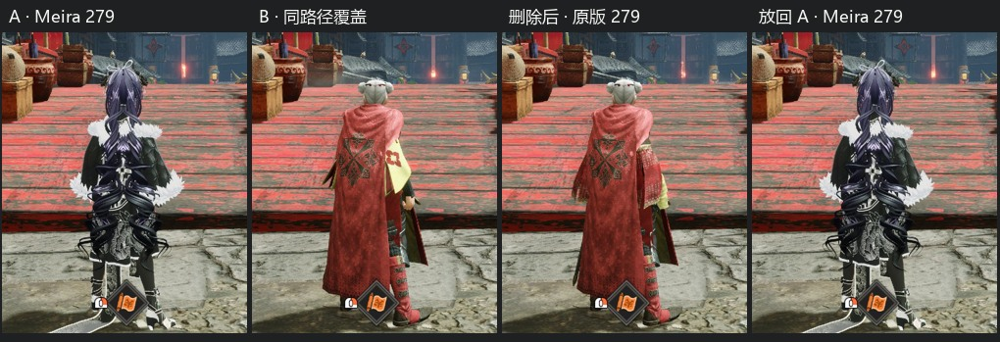
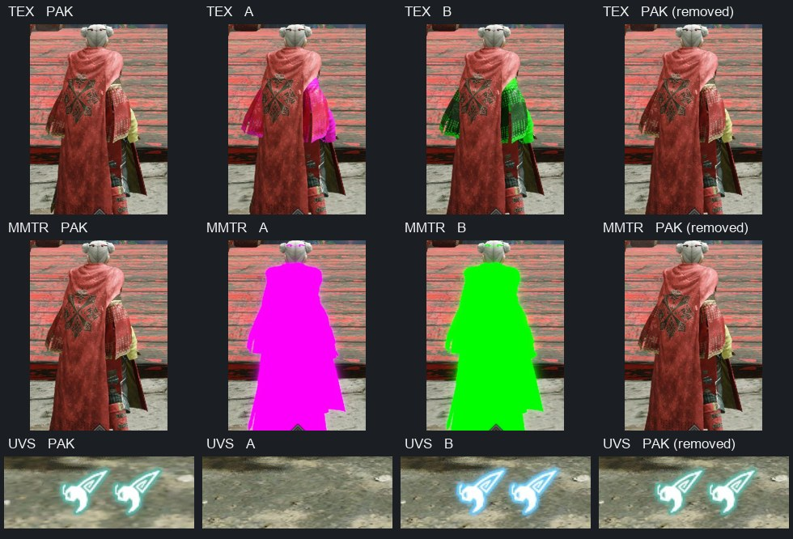
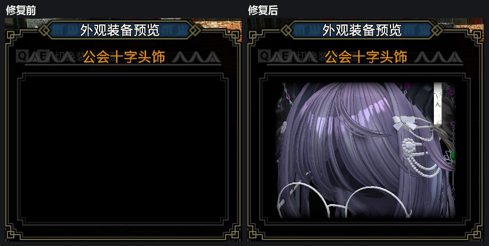

# 崛起 18 类资源的同路径替换与删除回退

实测版本为 Steam《怪物猎人：崛起》16.0.2.0，Build 17920865，REFramework c4b13148。测试保留相同的逻辑资源路径，先安装 A，用内容不同的 B 覆盖，再删除松散文件，由同一个游戏进程重新请求 PAK 原件。下表中的读数来自实际使用该资源的游戏对象。[逐项读数与文件哈希](reentry-18-results.json)

## 279 外观

A 是实际穿戴的 Meira 279，包含 13 份文件。B 把 265 手甲的配套模型和材质放在 279 路径，其余部件使用原版 279。切装测试通过游戏的装备加载请求把手甲切到 265，确认实际出现 `f_arm265`，再切回 279。直接重建测试保持 279 编号。各阶段均在村庄猎人的新对象上读回。

| 279 手甲 | A 套 | B 覆盖后 | 删除 B 后 | 放回 A 后 |
| --- | --- | --- | --- | --- |
| 实际材质槽 | 6 个 Meira 槽 | `f_arm265_01`、`skin_hand`、`f_arm265_ALPHA` | `Arm`、`Hand` | 原 6 槽 |
| Mesh 的 LOD 数 | 1 | 5 | 5 | 1 |
| Chain 的资源组数 | 15 | 2 | 2 | 15 |

切到 265 再切回与直接重建取得了相同的 B 和原版读数。直接调用 `requestChangePlayerLoad` 的探针运行在装备菜单外，新的玩家对象已就绪，但其根对象的绘制开关没有自动打开，该项验收取自组件。另用游戏的正常区域切换进入训练场再回村，四个阶段均生成了新的村庄猎人，角色绘制开启，槽数、LOD 和物理组数与上表一致。试验结束后逐一比对了 A 套 13 个文件的 SHA-256。此前也通过游戏道具箱菜单做过删除和放回的人工切换。[道具箱与画面对照](delete-reentry.md)

## 各类资源的验收

除玩家套装外，四项读数依次为 **PAK 原版、A、同路径 B、删除后的 PAK 原版**。每种资源使用自己的组件、工厂或渲染目标重新进入。普通组件样本还覆盖了一次复制多个文件、原地覆盖并保留文件修改时间的情况。

| 格式 | 实机检查 | 读数 |
| --- | --- | --- |
| MESH.2109148288 | 279 猎人手甲 | 见上表，两条换装路径 |
| MDF2.23 | 279 猎人材质 | 见上表。另在同一个组件中修改 MDF 默认值，运行时设置的 `moon_RimColor` 保留，`moon_RimParam2` 使用新文件值 |
| TEX.28 | 村内猎人的手甲固定区域 | 原色 → 洋红 → 绿色 → 原色 |
| MMTR.220427553 | 村内猎人的身体固定区域 | 原着色 → 洋红 → 绿色 → 原着色 |
| RTEX.5 / RTEX.5.stm | 普通 RTEX 的 A 和 B 都记录到重新打开文件。平台 RTEX 从 GUI 管理器实际绑定的预览目标读回宽高 | 680×512 → 95×64 → 191×95 → 680×512。另在加工店实测删除后头巾区域 103,950 个像素全部恢复 |
| UVS.7 | 翔虫 HUD，在每次更新后从村庄移动到训练场再回村 | 原图标 → 隐藏 → 同一图集中的另一块图标 → 原图标，按固定区域的青色像素核对 |
| EFX.2818730 | 重建 EffectPlayer 后的任务数 | 4 → 5 → 2 → 4 |
| UVAR.3 | Motion 中的变量组 | em001_00_mot → em002_00_mot → em003_00_mot → em001_00_mot |
| FBXSKEL.4 | CustomSkeleton 的根骨局部 X | 0 → 0.125 → 0.25 → 0 |
| CHAIN.48 | 组件中的物理资源组数 | 4 → 3 → 2 → 4 |
| JCNS.21 | 约束层的输出目标数 | 4 → 3 → 2 → 4 |
| MOTBANK.3 | 活动动作库 ID | [0,10] → [0,11] → [0,12] → [0,10] |
| MOTLIST.528 | 活动库内动作数 | 7 → 4 → 20 → 7 |
| MOT.495 | 村内播放中的水车末帧 | 239 → 119 → 179 → 239。另在训练场修改文件，再回村核对同一常驻水车 |
| RCOL.20 | ItemTake 碰撞体的外圈球半径 | 2.3 → 2.625 → 2.875 → 2.3 |
| GUI.430033 | 重建语音气泡的文字、纹理、纹理组节点数 | (1,0,0) → (19,27,1) → (1,1,1) → (1,0,0)。另测帧率 60 → 41 → 37 → 60 |
| PFB.17 | 同一预制体工厂下一次生成的根对象 | ItemTake → epvs_0004_ec010_00_0000 → hm12_001 → ItemTake。B 含 GimmickPop 等子对象，另测根节点时间倍率 |
| USER.2 | 重新创建的 WwiseEnemyMysterySettingsData 内嵌预制体引用 | MysteryMediaPrefab → ItemTake → hm12_001 → MysteryMediaPrefab。固定相机的插值时长另测 60 → 24 → 48 → 60 |

动作末帧和播放进度来自运行中的动作层。碰撞半径来自游戏中的实际形状。逐骨逐帧姿态、碰撞触发事件和所有特效发射方式尚未逐一比对。加工店画面对照使用普通宽高比，超宽资源的 A/B 检查使用同名资源和文件打开记录。[历次画面与组件实验](delete-reentry.md)

一次结构不同的 PFB 回退曾在重新创建 `ItemTake` 时退出。当前版本保留旧实例所用的预制体资源，等待正在加载的工厂就绪后再刷新，并保留包含该工厂引用的 USER。修订后，分别在 279 整套试验前后从新工厂生成对象，另做一次保留同一工厂的试验。三次均取得了表中的四个根对象。

下图从村内同一位置的游戏画面裁切。每行从左到右依次为原版、A、B、删除后的原版。

这组截图使用安装包里的默认监听命令。手甲同时替换基础贴图和流式高清层。身体所用的共享模板更新了 11 个正在使用的 MDF。翔虫 UVS 与另一个文件同时复制、覆盖和删除，每步都重新进入村庄。图标区域的青色像素依次为 1,200、0、2,945、1,219。图标本身有动画，原版两次采样有帧间差异。此次删除时，监听器给 14 个已就绪的活动节点绑定了原版图标。完成这三项后，直接重建玩家取得了 Meira 的原 6 个材质槽。

开发中曾因修改翔虫 UVS 时同时刷新常驻 GUI 与其预制体而在重新进入村庄时退出。当前版本保留常驻界面的时间线，给已就绪的纹理节点绑定新 UVS，同时处理重新打开的视图。上述四阶段使用了此前触发退出的图标样本，整个测试期间沿用同一游戏进程。

## 道具箱的单件外观预览

在道具箱选择公会十字头饰，整身角色正常，单件小窗全黑。旧版在预览关闭期间热加载了 `PreviewCamera_ObjMini.rtex`，重新打开窗口时，小窗相机又拿到了预制体里的旧目标。修复后，相机在游戏设置渲染目标时核对当前槽位。这个检查也在脚本载入时执行一次。相机与界面管理器引用同名资源的不同版本时，插件更新相机上的对应组件。

在同一个游戏进程里分别做了以下检查。

- 预览开着时，添加 A、用 B 覆盖、再删除单件预览的 RTEX。小窗一直显示同一头饰，游戏读回的渲染尺寸依次为 680×512、95×64、191×95、680×512。
- 完全退出道具箱，在村庄里添加、覆盖并删除同一个 RTEX。重新打开头饰后，两个相机输出组件与界面管理器都指向同一份 680×512 的原版目标。
- 同时添加 RTEX 和 `PreviewTexture_EquipMini.uvs`，在道具箱关闭时一起覆盖，回到头饰窗口看到 191×95 的 B。再次退回村庄并一起删除，重开后显示 680×512 的原版目标。随后在同一小窗中逐件查看了公会十字腕甲、腰甲与狸兽伪装。
- 已安装的 Meira 279 胸甲和腿甲使用两个内容相同的占位网格，材质名均为 `dummy`。临时移走这两个 MESH，切回对应部位，游戏显示原版公会十字战衣和靴子。放回两份文件后，这两格恢复为空。测试结束时逐字节核对了该套外观的 13 个松散文件。

## 使用条件

1. 启用 REFramework 的 LooseFileLoader，在 Debug 中取消勾选 **Enable file cache**。本次使用的版本在游戏重启时会恢复勾选。
2. 运行 `python tools/watch_outfit.py "<崛起游戏目录>"`。将同编号的一套文件复制到原路径，等监听器对这批文件打印 `Replaced` 或 `Removed` 后切装或重建。游戏原本有同名资源时，删除覆盖会回到 PAK。纯 Mod 自建路径的行为由引用它的上层资产决定。
3. 随包的 16.0.2 索引收录 154,118 条逻辑路径，其中 64,051 个资源有 344,082 条已核对的引用，另有 339 份模板的材质接口。监听器也会读取松散文件中的引用和场景材质实际使用的模板、贴图。`--baseline-root "<原版 natives/stm>"` 可提供字段差异检查所需的原件。索引的重新生成工具随包提供。
